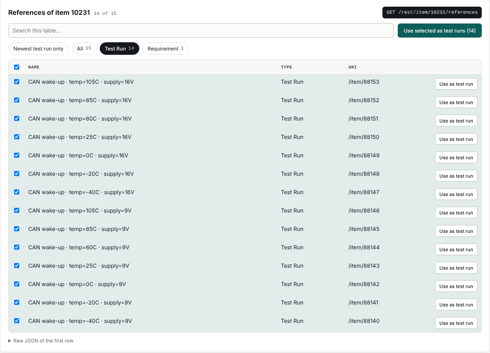

# CB Test Bridge

A web console that connects a **test management system** (ALM) to **your own test framework**:

1. **Extract** test runs from ALM by pasting a link — project, category or item — or use **Run multiple**
   to pick test cases grouped by their Testabläufe, creating a new test run per test case.
2. **Review and edit** them: steps, parameters, releases/versions, test configuration, time limit.
3. **Run** them one by one on the test system you choose, with hard time limits that really stop a test.
4. **Post results back** to ALM — live, once after review, or not at all.
5. **Automate it** from Jenkins or any CI through a small API ([CI / Jenkins](docs/ci-jenkins.md)).

The product name, logo and colours are configurable, so any company can run it under its own brand
(see [Branding](docs/branding.md)).



## Documentation

| Document | For | What it covers |
|---|---|---|
| [User guide](docs/user-guide.md) | Test engineers | Signing in, extracting, editing, My tests, running, posting results |
| [Installation & configuration](docs/installation-and-configuration.md) | Admins | Requirements, install, every setting, connecting real systems, troubleshooting |
| [Branding](docs/branding.md) | Admins | Company logo, name, colours, favicon |
| [Framework contract](docs/framework-contract.md) | Framework developers | The HTTP API your test framework must offer, time limits, verdicts |
| [CI / Jenkins](docs/ci-jenkins.md) | Admins, CI engineers | Trigger a category, a Testablauf or a single test from Jenkins; JUnit results |
| [Architecture](docs/architecture.md) | Developers | Layers, data flow, extension points (e.g. Xray), design decisions |

## Quick start (local, with the built-in stand-ins)

Needs the **.NET 8 SDK** and **Python 3.10+** with `pip install flask`.

```powershell
python mock_codebeamer/app.py                 # fake codebeamer   → http://localhost:5002/cb
python framework_stub/app.py --port 5001      # framework stand-in → http://localhost:5001
dotnet run --project src/CbBridge.Web         # the bridge         → URL printed in the console
```

Or in VS Code: *Run and Debug* → **Everything: bridge + framework stub + fake ALM** → F5.
Sign in with any username/password and paste `10231` (a test case with 14 generated test runs).
Details: [Installation & configuration](docs/installation-and-configuration.md).

## Repository layout

```
CbBridge/
├─ CbBridge.sln
├─ src/CbBridge.Core/           shared logic (class library, .NET 8, no NuGet packages)
│  ├─ Domain/                   payload and result types
│  ├─ Application/              selection, editing, run loop, CI jobs, options, branding — no HTTP details
│  └─ Infrastructure/           codebeamer clients (read: legacy REST, write: Swagger v3), framework client
├─ src/CbBridge.Web/            the web console + CI API (ASP.NET Core Blazor Server)
│  ├─ Components/               pages (sign-in, console) and shared UI
│  ├─ Ci/                       /api/ci endpoints for Jenkins
│  ├─ wwwroot/branding/         ← put your company logo here
│  └─ appsettings.json          all settings
├─ tools/ci/                    bridge_ci.py + Jenkinsfile
├─ framework_stub/              reference implementation of the framework contract (Flask + CLI)
├─ mock_codebeamer/             fake codebeamer for local development (invented data)
├─ docs/                        documentation
└─ .vscode/                     run/debug setup for VS Code
```

## Status

Working model. Verified end to end against the bundled stand-ins; **not yet verified against a real ALM
instance** — field names and the result upload format must be checked there first
(see [Installation & configuration → Connecting a real codebeamer](docs/installation-and-configuration.md#connecting-a-real-codebeamer)).
