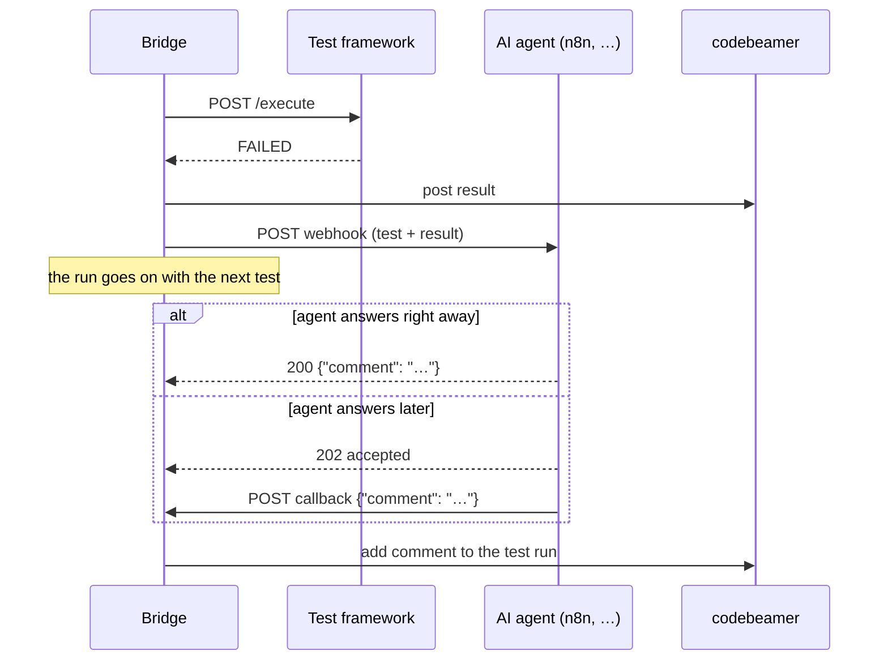

# AI analysis of failed tests

When a test fails, the bridge can send it to an **AI agent** that writes a short comment for developers:
which step failed, what the likely cause is, where to look first. The comment appears in the console, in the
result file and the JUnit report, and is added to the codebeamer test run.

The **agent is not part of this repository.** It can run on any platform that accepts a webhook — n8n, Zapier,
Make, Power Automate, or your own Python service — and use any model. This page is the contract between the
bridge and the agent: implement it, and the bridge works with your agent.

- [How it works](#how-it-works)
- [Switch it on](#switch-it-on)
- [The contract (cbbridge.analysis/v1)](#the-contract-cbbridgeanalysisv1)
- [Example: n8n](#example-n8n)
- [Test without a real agent](#test-without-a-real-agent)
- [Security and data](#security-and-data)

---

## How it works



- **Asynchronous:** the run never waits for the agent. The next test starts at once; the comment appears
  when it arrives.
- **Two switches:** *Analyse failed tests* for the run, and an *AI analysis* box on each test card to leave
  single tests out. In CI: `"analyze": true` / Jenkins parameter `AI_ANALYSIS`.
- **Only failures:** `FAILED`, `TIMEOUT` and `ERROR` by default (`Analysis:Verdicts`).
- **Comment in codebeamer** only when the result itself was posted there — live, or later with
  *Upload results*. Whichever of the two (result upload, agent answer) comes second triggers it; it is posted
  exactly once. Dry run is respected.
- **CI:** after the last test the job waits up to `Ci:AnalysisWaitSec` (300 s) for open analyses, so the
  comments are in the JUnit report (failure message and `system-out`).

## Switch it on

```json
"Analysis": {
  "Enabled": true,
  "WebhookUrl": "https://n8n.example.com/webhook/cbbridge-analysis",
  "AuthHeader": "Authorization",
  "AuthValue": "",
  "CallbackBaseUrl": "https://bridge.example.com"
}
```

Set the secret as an environment variable (`Analysis__AuthValue=Bearer …`), never in the file.
`CallbackBaseUrl` is only needed if the agent answers later; it must be reachable *from the agent*.
All settings: [Installation & configuration → Analysis](installation-and-configuration.md#analysis).

## The contract (cbbridge.analysis/v1)

### 1. Request — bridge → agent

`POST {WebhookUrl}`, `Content-Type: application/json`, plus `AuthHeader: AuthValue` if set.

```json
{
  "contract": "cbbridge.analysis/v1",
  "analysisId": "a1b2c3d4e5f6a7b8c9d0e1f2",
  "callback": {
    "url": "https://bridge.example.com/api/analysis/callback/a1b2c3d4e5f6a7b8c9d0e1f2",
    "token": "3f9c…",
    "header": "X-Callback-Token"
  },
  "hints": { "language": "en", "maxWords": 80 },
  "run": {
    "id": "20261016-184202-81a739",
    "source": "console",
    "label": null,
    "selection": "#88131, #88132",
    "frameworkUrl": "http://bench-a:5001"
  },
  "test": {
    "itemId": "88132",
    "testCaseId": null,
    "testablauf": null,
    "name": "Bluetooth pairing with 5 devices",
    "description": "Pair five phones in sequence.",
    "testConfiguration": "R4.3 / FW 4.3.0-rc2",
    "timeLimitSec": 60,
    "steps": [
      ["Enable pairing", "Head unit visible", true],
      ["Pair 5 devices", "5 paired", false],
      ["Reboot head unit", "5 still paired", true]
    ],
    "parameters": { "stepDelaySec": 1 }
  },
  "result": {
    "verdict": "FAILED",
    "durationSec": 3,
    "message": "failed step(s): 2",
    "framework": { "…": "the framework's full JSON answer, cut to MaxFrameworkChars" }
  },
  "codebeamer": {
    "baseUrl": "https://cb.example.com/cb",
    "testRunId": "88132",
    "itemUrl": "https://cb.example.com/cb/issue/88132"
  }
}
```

| Field | Notes |
|---|---|
| `callback` | `null` when the bridge has no `CallbackBaseUrl` — then the agent **must** answer directly. |
| `hints` | Wishes, not rules: language and length of the comment. |
| `run.source` | `console` or `ci`. `label` is e.g. the Jenkins build tag. |
| `test` | Exactly what was sent to the framework (after editing in the console). `steps` keep the codebeamer shape. |
| `test.testCaseId`, `testablauf` | Set for Run multiple. |
| `result.framework` | Whatever your framework returned — step results, logs, measurements. The richer, the better the analysis. |
| `codebeamer.testRunId` | `null` when the test is not in codebeamer (My tests, no run created, dry run). |

The request carries **no credentials** — no codebeamer login, no API keys. An agent that needs more context
(requirements, previous runs, source code) must have its own read access.

### 2. Answer — choose one

**a) Directly**, in the webhook response:

```http
HTTP/1.1 200 OK
Content-Type: application/json

{ "comment": "Step 2 'Pair 5 devices' failed …", "likelyArea": "Bluetooth stack", "confidence": 0.6 }
```

**b) Later**, via the callback: answer the webhook with `202 Accepted` (or a `200` without a comment, which is
what n8n's *Respond immediately* does), then:

```http
POST {callback.url}
X-Callback-Token: {callback.token}
Content-Type: application/json

{ "comment": "Step 2 'Pair 5 devices' failed …", "likelyArea": "Bluetooth stack", "confidence": 0.6 }
```

The bridge answers `200 {"accepted": true}`, or `404` for an unknown/expired ID or a wrong token. Each
ID/token pair works **once**, and only within `CallbackWaitSec` (900 s).

### 3. Rules for the answer

| Rule | Detail |
|---|---|
| The comment | The first non-empty text in `comment`, `summary`, `output` or `text` (`Analysis:CommentFields`). A one-element array (n8n) and a plain-text body also work. |
| Everything else | Any other fields (`likelyArea`, `confidence`, links …) are kept in the result file under `analysis.agentAnswer`. |
| Length | Keep it short — it is shown in a table row and as a codebeamer comment. Plain text, no Markdown. |
| No answer | If no comment arrives, the row shows *no comment* and the log says why. Nothing is posted. |
| Errors | Any HTTP error or timeout (`RequestTimeoutSec`, 90 s) → state `Failed`, logged, the run is unaffected. |

### What a good comment looks like

> Step 2 "Pair 5 devices" did not reach 5 pairings on FW 4.3.0-rc2; steps 1 and 3 passed, so the head unit
> works but the pairing list is likely capped. Check the max-pairings setting in the BT stack for this
> firmware first.

Point to a place (step, component, setting), say why, and stay honest about certainty. The bridge prefixes
the codebeamer comment with *"AI analysis (automatic, please verify):"*.

## Example: n8n

1. **Webhook** node — method `POST`, path `cbbridge-analysis`, authentication *Header Auth* (the same header
   and value as `Analysis:AuthHeader`/`AuthValue`).
   - Fast model, simple flow: *Respond* = *Using 'Respond to Webhook' node*.
   - Slow model or long flow: *Respond* = *Immediately*, and set `Analysis:CallbackBaseUrl`.
2. **AI Agent** (or *Basic LLM Chain*) node — prompt built from `{{$json.body.test}}` and
   `{{$json.body.result}}`, asking for at most `{{$json.body.hints.maxWords}}` words in
   `{{$json.body.hints.language}}`.
3. Answer:
   - synchronous: **Respond to Webhook** with JSON `{"comment": "{{$json.output}}"}`;
   - asynchronous: **HTTP Request** node — `POST {{$('Webhook').item.json.body.callback.url}}`, header
     `X-Callback-Token: {{$('Webhook').item.json.body.callback.token}}`, JSON body
     `{"comment": "{{$json.output}}"}`.

Zapier (*Catch Hook* → AI step → *Webhooks POST* to the callback) and Make work the same way.

## Test without a real agent

`tools/agent_stub/agent_stub.py` is a stand-in that implements this contract without any AI — it builds a
comment from the failed step. Use it to check the bridge side, and as a reference for the real agent.

```bash
python tools/agent_stub/agent_stub.py                              # answers directly, port 5003
AGENT_MODE=async AGENT_DELAY=4 python tools/agent_stub/agent_stub.py   # 202 + callback after 4 s
```

```bash
# bridge (Development) pointed at the stub
Analysis__Enabled=true Analysis__WebhookUrl=http://localhost:5003/analyze \
Analysis__CallbackBaseUrl=http://localhost:5000 dotnet run --project src/CbBridge.Web
```

Then run test run **88132** from the fake codebeamer (it fails at step 2). `GET http://localhost:5003/_received`
shows what the agent got; `GET http://localhost:5002/cb/_comments` the comment the bridge added.

## Security and data

- **Off by default.** Turning it on sends test names, steps, parameters and framework output to the agent's
  platform. Check that this is allowed — use a self-hosted n8n or a model your company has approved when the
  data is confidential.
- No credentials are ever sent to the agent.
- The callback endpoint accepts only open analysis IDs with their random token (compared in constant time),
  single use, for a limited time. It answers 404 while `Analysis:Enabled` is false.
- Use HTTPS for both the webhook and the callback.
- The comment is AI output: it is labelled as such in codebeamer and is a pointer, not a verdict.
