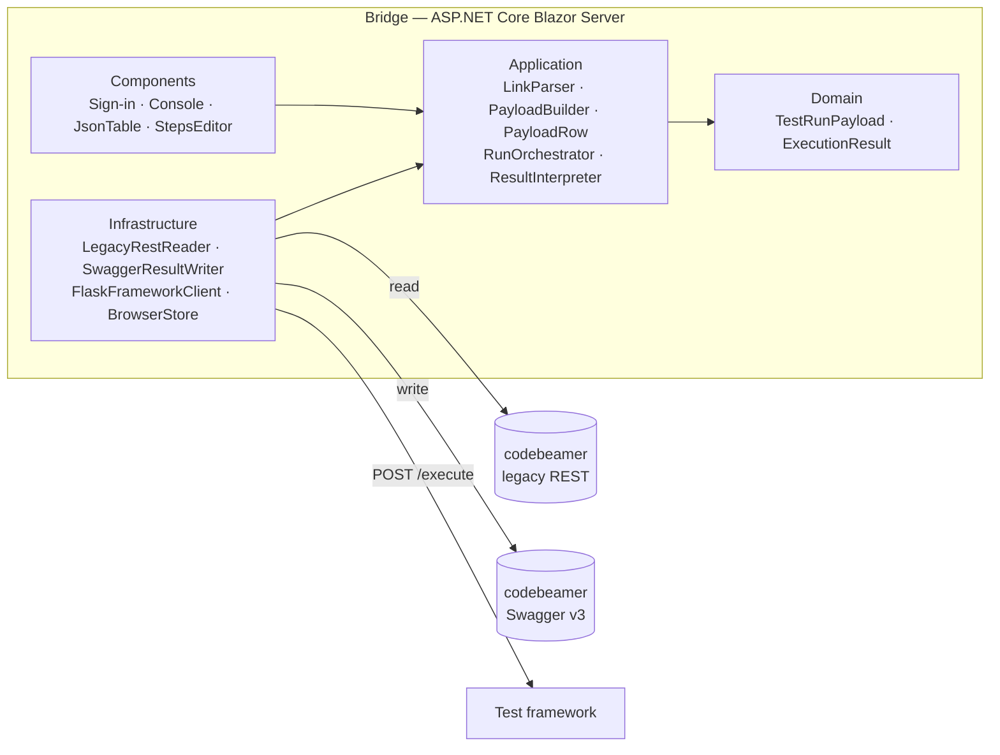
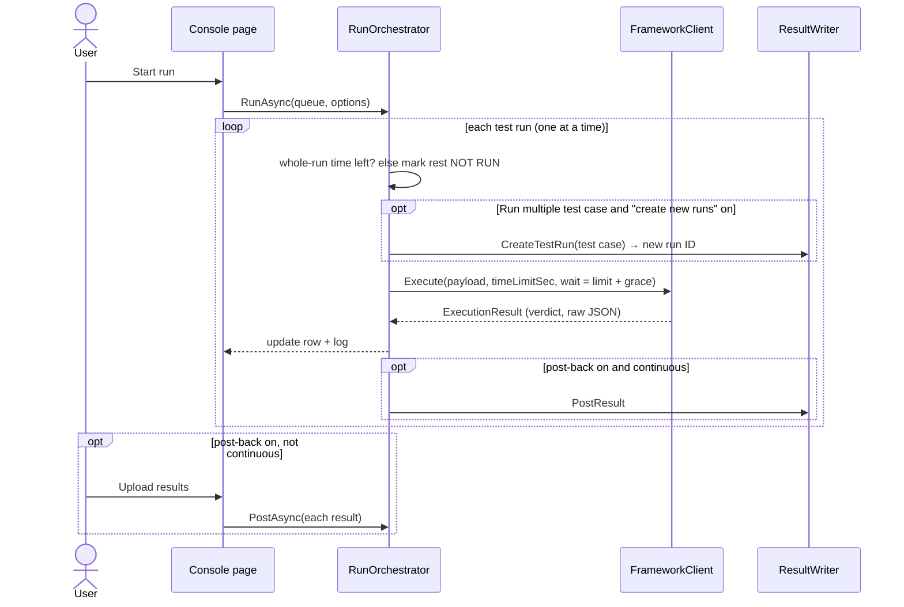

# Architecture

For developers extending or maintaining the bridge.

- [Overview](#overview)
- [Layers](#layers)
- [Flow of one run](#flow-of-one-run)
- [Key design decisions](#key-design-decisions)
- [Extension points](#extension-points)
- [Limits of the current model](#limits-of-the-current-model)

---

## Overview

Two projects, .NET 8, **no NuGet packages**:

| Project | Contains |
|---|---|
| `src/CbBridge.Core` (class library) | Domain, Application (selection, editing, run loop, CI jobs, options, branding) and Infrastructure (codebeamer and framework clients). No UI. Reusable by other hosts, e.g. a CLI. |
| `src/CbBridge.Web` (ASP.NET Core) | Blazor Server UI, the `/api/ci` endpoints, browser storage. |

The UI is Blazor Server: pages run on the server and the browser holds a live connection, so credentials and all
external calls stay server-side. The CI API uses the same Core services in its own scope per job.

## Layers

| Folder | Contains | May depend on |
|---|---|---|
| `Domain/` | What a test run payload and a result are | nothing |
| `Application/` | Use cases and rules: link parsing, item → payload mapping, editing state, run loop, verdict reading, options, branding | Domain; interfaces in `Application/Abstractions` |
| `Infrastructure/` | HTTP clients for codebeamer and the framework, per-user session, browser storage, DI setup | Application, Domain |
| `Components/` (Web) | Razor pages and UI components | everything above |
| `Ci/` (Web) | HTTP endpoints for Jenkins | Application (`CiRunner`, `CiJobStore`, `JUnitReport`) |

The layers are folders in one project to keep changes cheap while the model settles. The dependency rule is still
followed, so they can be split into separate projects later by moving folders.

**Ports** (`Application/Abstractions/Ports.cs`):

| Interface | Implemented by | Purpose |
|---|---|---|
| `ICodebeamerReader` | `LegacyRestReader` | projects, categories, outline, item, references |
| `ICodebeamerResultWriter` | `SwaggerResultWriter` | upload one result; create a new test run (Run multiple) |
| `IFrameworkClient` | `FlaskFrameworkClient` | execute, cancel, health check |

## Flow of one run

## Key design decisions

| Decision | Why |
|---|---|
| **Read with legacy REST, write with Swagger v3** | Matches how the target codebeamer setups are used; each direction is one class, so either can be swapped. |
| **Item JSON kept as `JsonNode`, field locations in config** | Every codebeamer instance is configured differently. `FieldMap` adapts without code changes; the *Raw JSON* panel shows the real names. |
| **Steps kept in codebeamer's positional shape** | `[Action, Expected, Critical?]` goes to the framework unchanged — no lossy conversion. |
| **Framework enforces `timeLimitSec`; bridge only as safety net** | Stopping the *wait* doesn't stop a test on hardware. See [Framework contract → Time limits](framework-contract.md#time-limits). |
| **Run multiple: new test run created right before each test case** | Nothing is created for test cases that never start (abort, whole-run limit); the framework gets the new run's ID. |
| **CI uses the same Core services, one DI scope per job** | Jenkins runs select, create and post exactly like the UI; each job has its own codebeamer session (the CI agent's login). |
| **One CI job per test system at a time** | Benches are exclusive; a second job for the same framework address waits. |
| **One test run at a time** | Benches are usually exclusive resources; sequential runs keep results and logs unambiguous. |
| **Credentials only in server memory, per tab** | Nothing sensitive in browser storage or on disk. |
| **User settings in encrypted browser storage** | My tests and test systems survive reloads without needing a server database yet. |
| **`PostBack:DryRun` on by default in production** | Nothing is written to a real codebeamer until an admin has checked the upload format. |
| **Branding by configuration** | Any company can run it under its own name and logo; colours validated to prevent CSS injection. |

## Extension points

| To add | Do this |
|---|---|
| A field sent to the framework | `Codebeamer:FieldMap:ExtraFields` in `appsettings.json` — no code. |
| Another step column | `Codebeamer:StepColumns` — no code. |
| Another test management system (e.g. **Xray / Jira**) | Implement `ICodebeamerReader`-style reading and `ICodebeamerResultWriter`-style writing for it, plus a link parser and mapping into `TestRunPayload`. The run loop, editing, time limits and UI stay as they are. (Renaming the ports to system-neutral names is the first step.) |
| Another framework protocol (CLI, gRPC, …) | Implement `IFrameworkClient`. |
| Authentication to the framework | Add headers in `FlaskFrameworkClient`. |

## Limits of the current model

- Verified against the bundled fake codebeamer and framework stand-in, **not yet against a real codebeamer**.
- No server-side database: no run history or audit trail; the run list is per browser tab.
- One run at a time per user; no shared queue or bench reservation.
- Parameters and releases/versions are edited as JSON text.
- No automated test suite yet; verification so far is end-to-end through the browser.
