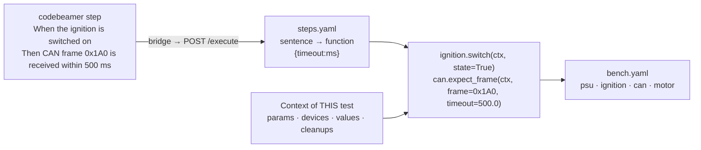
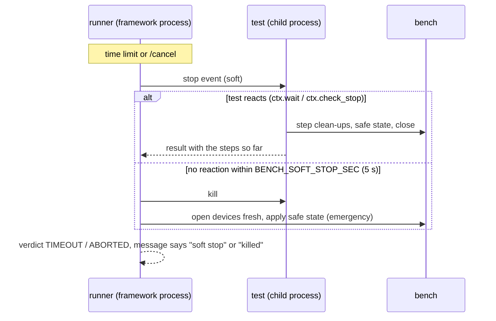

# Bench side: sentences, context per test, safe shutdown

How a test written in codebeamer becomes function calls on a test bench. This is the reference for the
**framework side** (`framework_stub/bench/`). The bridge itself doesn't change: it still sends the test run JSON to
`POST /execute` and gets the result back.

> All content here (devices, sentences, CAN IDs, limits) is an **invented, neutral example** on a **fake bench**.
> Replace the drivers and the step functions with your own; the mechanism stays the same.

- [The idea in one picture](#the-idea-in-one-picture)
- [Writing a test in codebeamer](#writing-a-test-in-codebeamer)
- [The files](#the-files)
- [Adding a sentence](#adding-a-sentence)
- [The context — objects per test](#the-context--objects-per-test)
- [Verdicts](#verdicts)
- [Stopping and the safe state](#stopping-and-the-safe-state)
- [Try it](#try-it)
- [Taking it into your framework](#taking-it-into-your-framework)

---

## The idea in one picture



1. **Plan:** every line of every step is matched against the catalogue *before anything runs*. One unknown
   sentence or wrong unit → verdict `BLOCKED`, with a "did you mean …", and **no device is touched**.
2. **Run:** step by step, each with `PASSED` / `FAILED` / `ERROR` and what was actually seen (`actual`).
3. **Close:** always — the step clean-ups, then the bench safe state, then the devices are closed.

## Writing a test in codebeamer

A codebeamer step has three cells: *Action*, *Expected result*, *Critical?*.

| Cell | How it is read |
|---|---|
| Action | Every line is **executed**. Keyword (`Given`/`When`/`And` …) optional. Several lines = several sentences, in order. |
| Expected result | Lines starting with `Then`/`And`/`But` (or `Dann`/`Und`/`Aber`), or `_KEYWORD(…)`, are **executed as checks**. Other text is only a description. |
| Critical? | A failed critical step ends the test. A failed non-critical step is recorded, the next step runs. |

Example (test run `88134` in the fake codebeamer):

| # | Action | Expected result | Critical |
|---|---|---|---|
| 1 | Given the bench is ready<br>And the supply is set to `<supply>`<br>And the supply output is switched on | Then the supply current is below 1 mA | ✓ |
| 2 | When the ignition is switched on | Then CAN frame 0x1A0 is received within 500 ms<br>And the wake-up time is below 300 ms | ✓ |
| 3 | When the ignition is switched off | ECU goes back to sleep *(text only)* | |

- `<supply>` is taken from the **test run's parameters** (`{"supply": "13.5 V"}`), so one test case with a parameter
  set (9 V / 13.5 V / 16 V …) generates many runs with the same sentences.
- Units are written the way people write them: `500 ms`, `0.5 s`, `13,5 V`, `150 mA`, `0x1A0`. The function always
  receives the base unit (ms, V, A …).
- Case, double spaces and a final full stop don't matter.

**Keyword style** works for the same steps, for people who prefer it — positional in sentence order, or by name:

```
_BENCH_READY
_PSU_SET(13.5 V)
_MOTOR_SET(direction=reverse, speed=900)
```

A test may mix both. A test without any sentence or keyword (plain "Switch ignition ON") still goes to the old
simulation in `executor.py`, so existing tests keep working.

## The files

```
framework_stub/
├─ app.py                 Flask: /execute /cancel /progress /health  +  GET /steps, POST /check
├─ runner.py              child process, time limit, SOFT STOP, kill, emergency safe state
├─ executor.py            sentence test → bench engine; plain test → old simulation
├─ cli.py                 --check, --steps, --in-process
├─ bench/
│  ├─ steps.yaml          the catalogue: sentence → function            ← test authors read this
│  ├─ bench.yaml          the devices of THIS bench + safe state        ← one per bench
│  ├─ registry.py         loads and checks steps.yaml, matches sentences
│  ├─ units.py            parameter types and units
│  ├─ context.py          Context per test
│  ├─ engine.py           plan → run → close
│  ├─ keywords/           the step functions (power, ignition, can, motor, common)
│  └─ devices/fake.py     the fake bench (simulated ECU, supply, CAN, motor)
├─ examples/              test run JSONs: pass, fail, blocked, soft stop, kill
└─ tests/test_bench.py    28 tests, no hardware
```

## Adding a sentence

Two edits, nothing else:

**1. The function** in `bench/keywords/<area>.py` — `ctx` first, then one parameter per placeholder:

```python
def expect_voltage_between(ctx, low, high):
    volts = ctx.measure("supply voltage", ctx.device("psu").measure_voltage(), "V", f"{low:g} … {high:g} V")
    if not low <= volts <= high:
        raise StepFailed(f"{volts:.2f} V, expected {low:g} … {high:g} V")
    return f"{volts:.2f} V"                     # becomes "actual" in the step result
```

**2. The entry** in `bench/steps.yaml`:

```yaml
  - sentence: "the supply voltage is between {low:V} and {high:V}"
    function: power.expect_voltage_between
    keyword: PSU_VOLTAGE_BETWEEN          # optional
    also: ["die Spannung liegt zwischen {low:V} und {high:V}"]   # optional
```

Restart the framework. If something doesn't fit — function missing, placeholder not a parameter of the function,
function needs a parameter the sentence doesn't have, unknown type, a sentence that collides with another, duplicate
keyword — **the framework refuses to start and lists every problem**. A typo is found at start-up, not on the
bench at night.

**Types:** `ms` `s` `V` `A` `rpm` `degC` `pct` `int` `float` `hex` `word` `text` (quoted) `onoff` (on/off/ein/aus) and
your own enums (`enums:` in steps.yaml, e.g. `direction: [forward, reverse]`). New unit types go in `units.py`.

**The catalogue for authors:** `GET /steps` (JSON) or `python cli.py --steps`. This is what to give test authors —
and later the bridge could use it for auto-completion in the editor.

## The context — objects per test

Every test gets a **new** `Context`, and it is thrown away after the test. Nothing is shared between tests.

| | |
|---|---|
| `ctx.params` | the test run's parameters (codebeamer parameter set) |
| `ctx.config` | the test configuration / firmware the bridge sent |
| `ctx.device("psu")` | the device object from `bench.yaml` — opened on first use, closed after the test |
| `ctx.values` | scratch space between steps: step 2 measures, step 3 checks |
| `ctx.measure(name, value, unit, limit)` | a measurement in the result JSON → history, codebeamer, AI analysis |
| `ctx.log(text)` | a line for the bench log (attached to the codebeamer run when the test fails) |
| `ctx.wait(s)`, `ctx.wait_until(fn, s)` | waiting that a stop request interrupts — **use these instead of `time.sleep`** |
| `ctx.on_cleanup(text, fn)` | undo something at the end, also when the test fails or is stopped; newest first |

Devices are **objects**, built by `bench.yaml`:

```yaml
devices:
  psu:      { driver: fake.PowerSupply, settings: { max_voltage: 30 } }
  can:      { driver: fake.CanBus, settings: { channel: can0, bitrate: 500000 } }
safe_state:
  - motor.stop
  - ignition.off
  - psu.output_off
```

A driver is any class built as `Class(settings, ctx)` with methods and an optional `close()`. Swap `fake.PowerSupply`
for `mylab.drivers.Psu` and the step functions don't change. One `bench.yaml` per bench (`BENCH_CONFIG=path`).

## Verdicts

| Verdict | When | The bench |
|---|---|---|
| `PASSED` | all checks held | safe state applied |
| `FAILED` | a check did not hold (`StepFailed` / `assert`) | safe state applied |
| `ERROR` | the bench had a problem: device error, exception — **the test stops there**; also when the test passed but a clean-up failed (the next test may not be safe) | safe state applied |
| `BLOCKED` | a sentence is unknown or a value has the wrong unit | **not touched** |
| `TIMEOUT` / `ABORTED` | time limit / `/cancel` | see below |

Every result also carries `measurements` and `bench: {name, safeState, cleanupErrors}`.

## Stopping and the safe state



- **Soft stop first:** the test ends its step, runs its clean-ups and the safe state itself.
- **Kill only if it doesn't react** (a hung driver call). Then the framework process opens the devices again and
  applies `safe_state` from `bench.yaml`. This is why real drivers must be able to open a device that a killed
  process left behind.
- Keep `BENCH_SOFT_STOP_SEC` well below the bridge's `Framework:GraceSeconds` (15 s).

## Try it

```bash
cd framework_stub
pip install -r requirements.txt                       # flask, pyyaml

python cli.py --steps                                  # the catalogue
python cli.py -i examples/bench-undefined.json --check # finds the typo and the wrong unit, runs nothing
python cli.py -i examples/bench-wakeup.json            # PASSED, with measurements
python cli.py -i examples/bench-wakeup-slow-ecu.json   # FAILED: wake-up 650 ms, limit < 300 ms
python cli.py -i examples/bench-motor.json             # keyword style; non-critical step 3 fails, step 4 runs
python cli.py -i examples/bench-hang.json              # TIMEOUT, soft stop, safe state reached
python cli.py -i examples/bench-block.json             # TIMEOUT, killed, emergency safe state

python -m unittest discover -s tests -v                # 28 tests
```

Through the bridge: start the stand-ins as usual and run test runs **88134** (passes) and **88135** (step 3 fails)
from the fake codebeamer. The result page shows the actual values per step; the framework answer contains the
measurements.

The fake bench can be made to misbehave through the test run's parameters: `fake.wakeMs` (ECU wake-up time),
`fake.motorMaxRpm`, `fake.sleepCurrentA`, `fake.psuFault: true` (device error).

## Taking it into your framework

The module is self-contained, so it can be taken over file by file:

1. Copy `bench/` next to your framework; `pip install pyyaml`.
2. Write **one driver class per device type** with the methods your steps need (the fake ones show the shape) and
   list them in a `bench.yaml` per bench.
3. Move your existing keyword functions into `bench/keywords/` with the signature `fn(ctx, …)`, and give each one a
   sentence (and its old keyword name) in `steps.yaml`.
4. In your `execute()`, call `bench.run_test(testrun, catalogue, bench_config, report_step, stop_event)` — exactly as
   `executor.py` does — and take over the soft stop from `runner.py`.
5. Replace every `time.sleep` in step functions with `ctx.wait`, so stopping works.

Nothing company-specific belongs in this repository: keep your real `steps.yaml`, `bench.yaml`, drivers and
functions in your framework's own repository.
