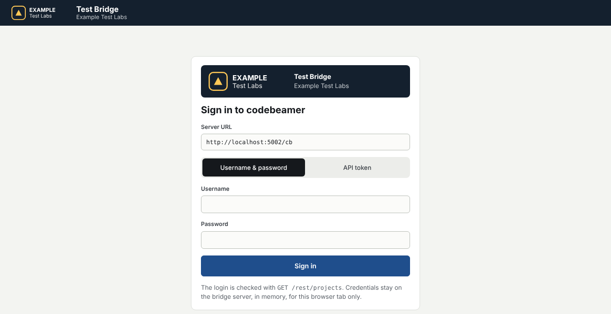

# Branding

Put any company's name, logo and colours on the bridge — configuration only, no code changes, no rebuild.



*The example uses a fictional company ("Example Test Labs") and the sample logo in `wwwroot/branding/example-logo.svg`.*

## In three steps

1. **Add the logo file** to `src/CbBridge.Web/wwwroot/branding/` (after publishing: `publish/wwwroot/branding/`).
2. **Edit the `Branding` section** of `appsettings.json`:

   ```json
   "Branding": {
     "ProductName": "Test Bridge",
     "CompanyName": "Your Company",
     "LogoUrl": "branding/your-logo.svg",
     "LogoHeight": 30,
     "FaviconUrl": "branding/favicon.png",
     "AccentColor": "#1F4E8C",
     "HeaderColor": "#14202E"
   }
   ```

3. **Restart** the bridge.

Or set the same values as environment variables, which is handy per installation or in Docker:

```powershell
$env:Branding__CompanyName = "Your Company"
$env:Branding__LogoUrl     = "branding/your-logo.svg"
$env:Branding__AccentColor = "#1F4E8C"
```

## What each setting changes

| Setting | Where it shows |
|---|---|
| `ProductName` | Top bar, sign-in card, browser tab title |
| `CompanyName` | Under the product name; logo alt text (for screen readers) |
| `Tagline` | Under the product name when `CompanyName` is empty |
| `LogoUrl`, `LogoHeight` | Top bar (and larger on the sign-in card). Empty = built-in mark |
| `FaviconUrl` | Browser tab icon |
| `AccentColor` | Primary buttons, links, highlights, selected rows (a light tint is derived automatically) |
| `HeaderColor` | Top bar background |

## Logo guidelines

- **Format:** SVG preferred; PNG with a transparent background also works. Width follows the height you set
  (max. 220 px wide in the top bar).
- **The logo always sits on `HeaderColor`** — in the top bar and on the band at the top of the sign-in card — so
  **one light (or white) version of the logo is enough.** Make sure it is visible on your `HeaderColor`.
- **External URL:** `LogoUrl` may be a full `https://` URL, but a local file avoids depending on another server.

## Colour rules

- Colours must be written as `#RRGGBB`. Anything else is ignored and the default is used (and logged at startup).
- `AccentColor` and `HeaderColor` carry **white text**, so they must be dark enough: a contrast of at least
  **4.5 : 1** with white. If not, the bridge still starts but logs a warning:
  `Branding:AccentColor #7FC4BE is too light for white text (contrast 2.0:1, needs 4.5:1). Pick a darker shade.`

## Several companies

Each company runs its own installation (its own codebeamer, its own benches), so each installation gets its own
`appsettings.json` or environment variables. One code base, any number of brands.
