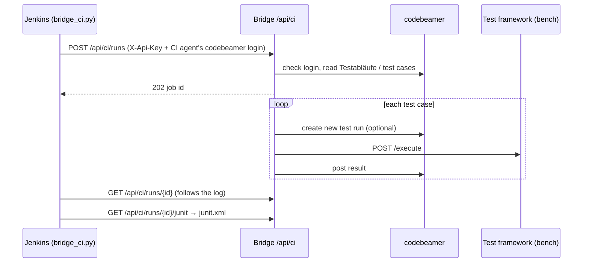

# CI / Jenkins

Run codebeamer tests from Jenkins (or any CI) without the browser: a whole category of Testabläufe, one
Testablauf, a single test case, or an existing test run. Results go to codebeamer as in the console, and Jenkins
gets a JUnit report, so every test case shows up in the build's *Test Result*.

- [How it works](#how-it-works)
- [Set up the bridge](#1-set-up-the-bridge)
- [Set up Jenkins](#2-set-up-jenkins)
- [Run it](#3-run-it)
- [Script reference](#script-reference)
- [HTTP API reference](#http-api-reference)
- [Security](#security)

---

## How it works



- Selection, test run creation, time limits and post-back are **exactly the same code** as in the browser.
- In CI, results are posted **as soon as each test finishes** (no review step).
- **One job per test system at a time:** a second job for the same framework address waits until the first is done.
  Different test systems run in parallel.
- **Jenkins "Abort"** stops the job on the bridge and the running test on the bench.

## 1. Set up the bridge

In `appsettings.json` (or environment variables `Ci__Enabled`, `Ci__ApiKey`):

```json
"Ci": {
  "Enabled": true,
  "ApiKey": "<long random secret>",
  "DefaultTimeLimitSec": 120,
  "DefaultOverallLimitSec": 3600
}
```

Generate a key, e.g. `openssl rand -hex 32` (Linux) or, in PowerShell 7,
`[Convert]::ToHexString([Security.Cryptography.RandomNumberGenerator]::GetBytes(32))`.
For Run multiple with new test runs, `RunMultiple:TestRunTrackerId` must be set as well
([Installation & configuration](installation-and-configuration.md#runmultiple)).

The API is **off by default**: with `Enabled: false` every `/api/ci` call answers 404.

## 2. Set up Jenkins

1. **Credentials** (*Manage Jenkins → Credentials*):

   | ID | Kind | Content |
   |---|---|---|
   | `codebeamer-ci-agent` | Username with password | The CI agent's codebeamer account (needs read access, and write access to test runs if results are posted) |
   | `cb-test-bridge-api-key` | Secret text | A bridge API key with `runs:start` + `runs:read` (an `Api:Clients` entry, see [API](api.md#keys-and-scopes)), or the older single `Ci:ApiKey` |

   With a codebeamer API token instead of a password, store it as *Secret text* and expose it as `CB_TOKEN`.

2. **Agent:** Python 3.8 or newer. No packages to install; works on Linux and Windows agents.

3. **Pipeline:** create a Pipeline job that uses `tools/ci/Jenkinsfile` from this repository (or copy it into your
   test repository together with `tools/ci/bridge_ci.py`). Set `BRIDGE_URL` in it to your bridge.

## 3. Run it

*Build with Parameters*:

| Parameter | Example | Meaning |
|---|---|---|
| `SCOPE` | `category` | `category`, `testablauf`, `test-case` (a single test) or `test-run` |
| `ID` | `4480` or a codebeamer link | What to run |
| `ONLY_TEST_CASES` | `10232,10234` | Optional filter inside a category / Testablauf |
| `RELEASE`, `VERSIONS` | `R5.0` · `FW 5.0.1,HW D1` | Release/versions for this execution → Test Configuration and new test runs |
| `FRAMEWORK_URL` | `http://bench-a:5001` | Test system; empty = bridge default |
| `CREATE_NEW_RUNS` | ✔ | New codebeamer test run per test case |
| `POST_BACK` | ✔ | Write results to codebeamer |
| `AI_ANALYSIS` | ☐ | Send failed tests to the AI agent; comments appear in the JUnit report ([AI analysis](ai-analysis.md)) |

Build result:

| Script exit code | Meaning | Jenkins build |
|---|---|---|
| 0 | all tests passed | SUCCESS |
| 1 | some tests failed, timed out or were not run | UNSTABLE (from the `junit` step) |
| 2 | could not run: wrong key or login, unknown ID, bench unreachable, job failed/aborted | FAILURE |

**Nightly or triggered runs:** add `triggers { cron('H 2 * * *') }` to the Jenkinsfile with default parameter
values, or trigger the job remotely (Jenkins *Trigger builds remotely*) from another system with `SCOPE` and `ID`.

## Script reference

`tools/ci/bridge_ci.py` — usable from any CI, not only Jenkins.

```text
python bridge_ci.py --bridge URL  (--category ID | --testablauf ID | --test-case ID | --test-run ID)
                    [--only IDS] [--release NAME] [--versions NAMES] [--framework-url URL]
                    [--codebeamer-url URL] [--no-new-runs] [--no-post-back] [--analyze]
                    [--time-limit S] [--overall-limit S] [--label TEXT]
                    [--junit FILE] [--poll S] [--max-wait S] [--insecure]
```

Credentials only from environment variables: `BRIDGE_API_KEY`, and `CB_USER` + `CB_PASSWORD` or `CB_TOKEN`.
`--label` defaults to Jenkins' `BUILD_TAG`, so the bridge log shows which build started the job.

## HTTP API reference

All calls need `X-Api-Key`. Starting a run also needs the codebeamer login in `Authorization`
(`Basic base64(user:password)` or `Bearer <token>`).

| Call | Answer |
|---|---|
| `POST /api/ci/runs` | `202 {id, state, statusUrl, junitUrl}` · `400` bad request · `401` wrong key or codebeamer login · `404` API disabled |
| `GET /api/ci/runs/{id}?logFrom=n` | Status, summary, results, log lines from `n` on, and `runId` — the run in the history ([/history/{runId}](user-guide.md#9-history), `/api/v1/runs/{runId}`) |
| `GET /api/ci/runs/{id}/junit` | JUnit XML |
| `POST /api/ci/runs/{id}/abort` | Stops the job (and the running test) |
| `GET /api/ci/runs` | The latest 50 jobs |

Request body (exactly one of `category`, `testablauf`, `testRun`, `testCase` — ID or codebeamer link):

```json
{
  "category": "4480",
  "onlyTestCases": ["10232", "10234"],
  "release": "R5.0",
  "versions": ["FW 5.0.1", "HW D1"],
  "frameworkUrl": "http://bench-a:5001",
  "createNewRuns": true,
  "postBack": true,
  "analyze": false,
  "timeLimitSec": 120,
  "overallLimitSec": 3600,
  "label": "jenkins-nightly-42"
}
```

Example without the script:

```bash
curl -s -X POST "$BRIDGE_URL/api/ci/runs" \
  -H "X-Api-Key: $BRIDGE_API_KEY" -u "$CB_USER:$CB_PASSWORD" \
  -H "Content-Type: application/json" -d '{"testCase":"10232","frameworkUrl":"http://bench-a:5001"}'
```

## Security

- The API is **disabled** unless `Ci:Enabled` is true, and then requires an **API key** with the right scope
  (`runs:start` to start or abort, `runs:read` for status and JUnit; compared in constant time).
- The **codebeamer login** of the CI agent comes with each start request, is checked against codebeamer before the
  job is accepted, kept in memory only while the job runs, and never written to disk or logs.
- Job IDs are random; status and JUnit calls also require the API key.
- Use **HTTPS** to the bridge — the start request carries the codebeamer login.
- Job status is kept in memory (`Ci:KeepJobs`, default 100) and is gone after a bridge restart; the **result files**
  of every CI run stay in the results folder ([Installation & configuration → Results](installation-and-configuration.md#results)).
