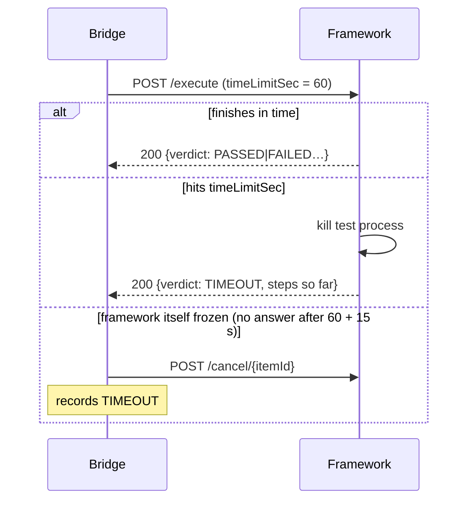

# Framework contract

What a test framework must offer so the bridge can run tests on it. Any language works; the bundled
`framework_stub/` (Python, Flask) is a complete reference implementation.

- [Endpoints](#endpoints)
- [POST /execute — request](#post-execute--request)
- [POST /execute — response](#post-execute--response)
- [Time limits](#time-limits)
- [POST /cancel/{itemId}](#post-cancelitemid)
- [GET /health](#get-health)
- [Developer command line](#developer-command-line)
- [Implementing it in your framework](#implementing-it-in-your-framework)

---

## Endpoints

| Method & path | Required | Purpose |
|---|---|---|
| `POST /execute` | yes | Run **one** test run, answer with its result |
| `POST /cancel/{itemId}` | yes | Stop the test run that is currently running for `itemId` |
| `GET /health` | no | Lets users check the connection (a 404 still counts as "reachable") |

Paths are configurable on the bridge (`Framework:ExecutePath`, `CancelPath`, `HealthPath`).
The bridge sends test runs **one at a time** and waits for each answer.

## POST /execute — request

`Content-Type: application/json`

```json
{
  "itemId": "88131",
  "name": "CAN bus wake-up on ignition",
  "parent": "88130",
  "description": "ECU must wake within 500 ms after ignition ON.",
  "testRunSteps": [
    ["Switch ignition ON", "CAN traffic starts", true],
    ["Measure wake-up time", "< 500 ms", true]
  ],
  "parameters": { "stepDelaySec": 1 },
  "modifier": "jdoe",
  "testConfiguration": "R4.3 / FW 4.3.1, HW C2",
  "timeLimitSec": 60,
  "releases": [ { "uri": "/item/7001", "name": "R4.3" } ],
  "versions": [ { "uri": "/item/7101", "name": "FW 4.3.1" }, { "uri": "/item/7102", "name": "HW C2" } ]
}
```

| Field | Type | Notes |
|---|---|---|
| `itemId` | string | codebeamer item ID, or `local-xxxxxx` for tests written in the bridge. Use it for `/cancel`. |
| `name` | string | As edited by the user. |
| `parent` | string \| null | Parent item ID. |
| `description` | string \| null | |
| `testRunSteps` | array \| null | codebeamer shape: one array per step, `[Action, Expected result, Critical?, …]`. |
| `parameters` | any JSON \| null | Passed through unchanged. |
| `modifier` | string \| null | Last modifier's user name. |
| `testConfiguration` | string \| null | Composed from release/version names (configurable), editable by the user. |
| `timeLimitSec` | integer | **You must stop the test after this many seconds** — see [Time limits](#time-limits). |
| *extra keys* | any JSON | Each `Codebeamer:FieldMap:ExtraFields` entry, by default `releases` and `versions`. Ignore keys you don't need. |
| `testCaseId`, `testablauf` | string, `{id, name}` | **Run multiple only.** The test case being run and the Testablauf it was picked from. |

**Run multiple:** when the bridge creates a new codebeamer test run for a test case, `itemId` is the **new test
run's ID** (and `/cancel` uses it); `testCaseId` keeps the test case. Without a new run, `itemId` is the test case ID.

## POST /execute — response

Answer with **HTTP 200 and a JSON body once the test ran** — also when it failed or timed out.
Use 4xx only when the request itself is unusable (e.g. 400 missing fields, 409 already running).

```json
{
  "itemId": "88131",
  "verdict": "PASSED",
  "message": "",
  "durationSec": 2.01,
  "steps": [
    { "index": 1, "action": "Switch ignition ON", "expected": "CAN traffic starts",
      "critical": true, "actual": "as expected", "verdict": "PASSED" }
  ]
}
```

| Field | Required | Notes |
|---|---|---|
| `verdict` | yes | `PASSED`, `FAILED`, `BLOCKED`, `TIMEOUT`, `ABORTED` or `ERROR` (also accepted: `PASS`, `OK`, `FAIL`, `TIMED_OUT`, `CANCELLED`). Field name configurable: `Framework:VerdictFields`. |
| `message` | no | Short reason shown in the results table. Configurable: `Framework:MessageFields`. |
| `durationSec` | no | Shown as the duration; otherwise the bridge measures it. |
| anything else | no | Shown in full under **JSON** in the results table and attached to the codebeamer upload. |

**Critical steps:** the reference implementation stops at the first failed step marked *critical* and continues
after a failed non-critical step. Follow the same rule unless your process says otherwise.

## Time limits

There are two limits, and each has a clear owner:

| Limit | Owner | Behaviour |
|---|---|---|
| **Per test run** (`timeLimitSec`) | **your framework** | Stop the test at `timeLimitSec` and still answer with `verdict: "TIMEOUT"` and the steps that finished. |
| Safety net | bridge | If no answer arrives within `timeLimitSec + GraceSeconds` (default 15 s), the bridge calls `/cancel/{itemId}` and records TIMEOUT itself. |
| **Whole run** | bridge | Checked between test runs; the last test's `timeLimitSec` is reduced to the time left. Tests that never started are NOT RUN. |

Why the framework must enforce it: if the bridge only stopped *waiting*, the test would keep running on the bench
— occupying it or still driving hardware. Run each test in a **child process** so it can always be killed;
a thread cannot be forced to stop. If tests start their own tools or simulators, kill the whole process tree.



## POST /cancel/{itemId}

Stop the running test run with this `itemId`. Used for the **Abort** button and as the safety net.

| Response | When |
|---|---|
| `200 {"cancelled": true}` | A running test was stopped. The pending `/execute` call should then answer `verdict: "ABORTED"`. |
| `404 {"cancelled": false}` | Nothing running under that ID. |

## GET /health

Any 2xx means healthy. Optional — without it, *Test connection* reports "reachable (no /health route)".

## Developer command line

The reference implementation includes a CLI that takes **the same JSON** as `/execute`. In the bridge, **Input JSON**
on any test run downloads that file. Replay it without bridge, codebeamer or Flask:

```powershell
python framework_stub/cli.py --input testrun-88131.json                  # with time limit, child process
python framework_stub/cli.py --input testrun-88131.json --in-process     # no child process: breakpoints work
python framework_stub/cli.py --input testrun-88131.json --output result.json --time-limit 20
```

Exit code 0 = PASSED, 1 = anything else — usable in scripts and CI.

## Implementing it in your framework

`framework_stub/` is split so the HTTP layer and the time-limit handling can be reused as they are:

| File | Role | Keep or replace |
|---|---|---|
| `app.py` | Flask endpoints, request checks | keep (adapt port/host) |
| `runner.py` | child process, `timeLimitSec`, cancel, partial results | keep |
| `executor.py` | runs the steps | **replace `execute()` with a call into your framework** |
| `cli.py` | developer command line | keep |

`execute(testrun, report_step)` receives the request JSON and must return the response JSON. Call
`report_step(step_result)` after each step so finished steps survive a timeout or cancel.

Start it with `python app.py --port 5001` (add `--host 0.0.0.0` to accept calls from other machines).
On Windows, keep the `if __name__ == "__main__":` guard in `app.py` — child processes re-import the module.
