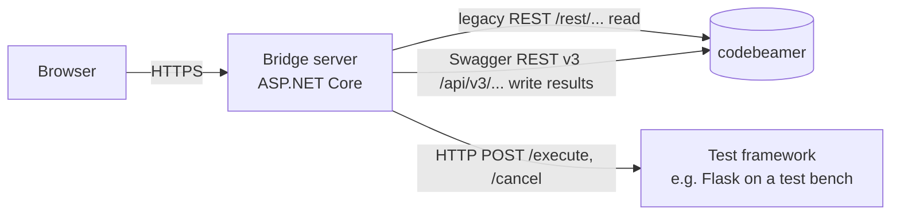

# Installation & configuration

For the administrator who installs the bridge and connects it to codebeamer and the test framework.

- [How the pieces connect](#how-the-pieces-connect)
- [Requirements](#requirements)
- [Run locally for evaluation](#run-locally-for-evaluation)
- [Install on a server](#install-on-a-server)
  - [Linux](#linux)
- [Settings reference](#settings-reference)
- [Connecting a real codebeamer](#connecting-a-real-codebeamer)
- [Connecting your test framework](#connecting-your-test-framework)
- [Security notes](#security-notes)
- [Troubleshooting](#troubleshooting)

---

## How the pieces connect



- Browsers talk **only** to the bridge server.
- The **bridge server** (not the browser) must reach codebeamer and every test framework address users enter.
- One bridge server can serve many users; each user signs in with their own codebeamer account.

## Requirements

| Component | Requirement |
|---|---|
| Bridge | .NET 8 (SDK to build, ASP.NET Core Runtime 8 to run). Windows or Linux (macOS works for development). No NuGet packages. |
| Browser | Any current Chrome, Edge, Firefox or Safari. |
| codebeamer | Legacy REST (`/rest`) for reading and Swagger REST v3 (`/api/v3`) for writing results; a user or API token with read access, plus write access to test runs if results are posted. |
| Test framework | Implements the [framework contract](framework-contract.md). The bundled `framework_stub/` (Python 3.10+, Flask) is a reference. |

## Run locally for evaluation

```powershell
pip install flask
python mock_codebeamer/app.py                 # fake codebeamer   → http://localhost:5002/cb
python framework_stub/app.py --port 5001      # framework stand-in → http://localhost:5001
dotnet run --project src/CbBridge.Web         # the bridge (builds Core too)
```

`dotnet run` uses `appsettings.Development.json`: the fake codebeamer is pre-filled and results are really
posted (to the fake server). Sign in with any username/password.

**VS Code:** open the folder, accept the recommended extensions (C#, Python, Python Debugger), then
*Run and Debug* → **Everything: bridge + framework stub + fake codebeamer** → F5.
**Visual Studio 2022:** open `CbBridge.sln`, start the two Python services separately, F5.

> **NuGet blocked?** If the build stops with *"Unable to load the service index … api.nuget.org"*, the
> network blocks NuGet. The project has no packages, so build offline:
> `dotnet build src/CbBridge.Web -p:RestoreSources=%TEMP%`.

> **"Create a trusted self-signed certificate?"** in VS Code: safe to accept or cancel. The VS Code
> setup runs on plain `http://localhost:5150`; the certificate is only for local HTTPS.

## Install on a server

### 1. Publish

```powershell
dotnet publish src/CbBridge.Web -c Release -o publish
```

`publish/` contains everything needed. Copy it to the server together with your edited
`appsettings.json` and your logo in `publish/wwwroot/branding/`.

### 2. Run

**Directly** (simplest; put it behind your reverse proxy or run it as a service with your usual tool):

```powershell
cd publish
dotnet CbBridge.Web.dll --urls http://0.0.0.0:8080
```

**IIS (Windows):** install the *ASP.NET Core 8 Hosting Bundle*, create a site pointing to `publish/`
with an application pool set to *No Managed Code*. This is the standard ASP.NET Core hosting procedure.

**Linux:** see [Linux](#linux) below — systemd service and Docker.

> Tested: the published app running directly on Linux (Ubuntu 24.04) in Production mode, and the whole
> application in Development mode on Linux. IIS, systemd and Docker follow the standard ASP.NET Core
> procedures but were not run with this project yet.

### Linux

The bridge, the framework stand-in and the fake codebeamer all run on Linux; test benches can stay on Windows,
because the bridge only reaches them over HTTP.

**Install the runtime** (Ubuntu 24.04 ships it in its own repositories):

```bash
sudo apt-get install -y aspnetcore-runtime-8.0     # to run   (use dotnet-sdk-8.0 to build)
```

**Things that differ from Windows**

| Topic | What to do |
|---|---|
| File names are case-sensitive | `Branding:LogoUrl` must match the file exactly — `branding/Logo.svg` ≠ `branding/logo.svg`. |
| Ports below 1024 need root | Run on e.g. 8080 and put nginx/Apache/Caddy in front for port 443 and HTTPS. |
| Result files | Written to `Results:Folder` (default `results/` next to the app). With systemd, make sure the service user can write there, or set an absolute folder such as `/var/lib/cbbridge/results`. |
| Encryption keys for browser storage | Kept in `~/.aspnet/DataProtection-Keys` of the user running the bridge. Keep that folder across updates and restarts — otherwise users' saved tests and test systems can no longer be read (they are ignored, nothing breaks). |
| Startup log: *Failed to determine the https port for redirect* | Harmless when HTTPS is handled by the reverse proxy. |

**As a systemd service**

```bash
sudo useradd --system --create-home --home-dir /var/lib/cbbridge cbbridge
sudo mkdir -p /opt/cbbridge && sudo cp -r publish/* /opt/cbbridge/
sudo chown -R cbbridge: /opt/cbbridge
```

```ini
# /etc/systemd/system/cbbridge.service
[Unit]
Description=CB Test Bridge
After=network.target

[Service]
WorkingDirectory=/opt/cbbridge
ExecStart=/usr/bin/dotnet /opt/cbbridge/CbBridge.Web.dll --urls http://0.0.0.0:8080
Restart=always
User=cbbridge
Environment=ASPNETCORE_ENVIRONMENT=Production
# Branding or other settings can also go here, e.g.:
# Environment=Branding__CompanyName=Your Company

[Install]
WantedBy=multi-user.target
```

```bash
sudo systemctl daemon-reload
sudo systemctl enable --now cbbridge
journalctl -u cbbridge -f          # logs
```

The service user has a home folder (`/var/lib/cbbridge`), so the encryption keys persist there.

**With Docker**

```dockerfile
FROM mcr.microsoft.com/dotnet/aspnet:8.0
WORKDIR /app
COPY publish/ .
ENV ASPNETCORE_URLS=http://+:8080
EXPOSE 8080
USER $APP_UID
ENTRYPOINT ["dotnet", "CbBridge.Web.dll"]
```

```bash
docker build -t cbbridge .
docker run -d --name cbbridge -p 8080:8080 \
  -v cbbridge-keys:/home/app/.aspnet/DataProtection-Keys \
  -v "$PWD/branding:/app/wwwroot/branding:ro" \
  -e Branding__CompanyName="Your Company" \
  -e Branding__LogoUrl="branding/logo.svg" \
  cbbridge
```

- The **`cbbridge-keys` volume is important**: without it, every container restart creates new keys and users'
  saved tests and test systems are lost.
- Add a volume for results too, e.g. `-v cbbridge-results:/app/results`, or they are lost with the container.
- The **branding folder** is mounted from the host, so a new logo needs no new image.
- `USER $APP_UID` runs the app as the non-root `app` user that the official .NET 8 images provide.

**Framework stand-in on Linux:** `python3 framework_stub/app.py --host 0.0.0.0 --port 5001`, or
`./run-stubs.sh` to start it together with the fake codebeamer.

### 3. Production behaviour

Outside Development, **`PostBack:DryRun` is `true`**: uploads are logged, not sent. Switch it off only after
you checked the upload format ([below](#connecting-a-real-codebeamer)).

## Settings reference

All settings live in `src/CbBridge.Web/appsettings.json`. Any setting can also be overridden with an
environment variable, using `__` for nesting — e.g. `Branding__CompanyName=Acme`, `PostBack__DryRun=false`.

### `Branding`

See [Branding](branding.md).

| Key | Default | Meaning |
|---|---|---|
| `ProductName` | `CB Test Bridge` | Name in the top bar, sign-in page and browser tab |
| `Tagline` | `Test management ⇄ test framework` | Subtitle, shown when `CompanyName` is empty |
| `CompanyName` | *(empty)* | Subtitle and logo alt text |
| `LogoUrl` | *(empty = built-in mark)* | e.g. `branding/logo.svg` or a full `https://` URL |
| `LogoHeight` | `28` | Logo height in the top bar, px |
| `FaviconUrl` | *(empty)* | e.g. `branding/favicon.png` |
| `AccentColor` | `#0E5E5A` | Buttons and highlights, `#RRGGBB`, dark enough for white text |
| `HeaderColor` | `#15181C` | Top bar, `#RRGGBB`, dark enough for white text |

### `Codebeamer`

| Key | Default | Meaning |
|---|---|---|
| `DefaultBaseUrl` | `https://cb.yourcompany.com/cb` | Pre-filled on the sign-in page |
| `LegacyPrefix` | `/rest` | Legacy REST — all reading |
| `V3Prefix` | `/api/v3` | Swagger REST v3 — uploading results |
| `PingPath` | `/projects` | Read call used to check a login |
| `StepColumns` | `Action`, `Expected result`, `Critical?` | Column titles of the steps grid. A title ending in `?` is a checkbox. Add titles if your steps have more columns. |

### `Codebeamer:FieldMap` — where each value is found in the item JSON

Paths: a dot means nested (`parent.name`), a comma means *try these in order* (`testRunSteps,testSteps`).

| Key | Default | Becomes |
|---|---|---|
| `ItemId` | `id,uri` | `itemId` (digits are taken from a `uri` like `/item/1234`) |
| `Name` | `name` | `name` |
| `Parent` | `parent` | `parent` (its ID) |
| `Description` | `description` | `description` |
| `TestRunSteps` | `testRunSteps,testSteps` | `testRunSteps` |
| `Parameters` | `parameters,testParameters` | `parameters` |
| `Modifier` | `modifier` | `modifier` (the user name) |
| `ExtraFields` | `releases ← releases,release`; `versions ← versions,version` | Each entry is sent as its own top-level key. Add more without code changes, e.g. `"preAction": "preAction"`. |
| `TestConfigurationTemplate` | `{releases} / {versions}` | How `testConfiguration` is composed; `{key}` = names in that extra field |
| `TestConfigurationNameSeparator` | `, ` | Joins several names in one field |

### `Framework`

| Key | Default | Meaning |
|---|---|---|
| `BaseUrl` | `http://localhost:5001` | Starting address; users choose their own test system in the UI |
| `ExecutePath` | `/execute` | Run one test run |
| `CancelPath` | `/cancel/{itemId}` | Stop a running test run |
| `HealthPath` | `/health` | Used by *Test connection* (404 still counts as reachable) |
| `GraceSeconds` | `15` | Extra wait beyond `timeLimitSec` before the bridge gives up and cancels |
| `VerdictFields` | `verdict,result,status` | Where the verdict is in the framework's answer |
| `MessageFields` | `message,error` | Where a message is in the framework's answer |

### `RunMultiple`

| Key | Default | Meaning |
|---|---|---|
| `TestRunTrackerId` | *(empty)* | ID of the test run tracker/category where new test runs are created. **Required** for creating runs. |
| `CreatePath` | `/trackers/{trackerId}/testruns` | Swagger v3 call (after `V3Prefix`) that creates a test run. |
| `TestCaseField` | *(empty)* | Empty = a Testablauf's test cases are its **references**. Or a field of the Testablauf item that lists them, e.g. `testCases`. |
| `TestCaseTypes` | `Test Case`, `Testfall` | References whose type contains one of these count as test cases. |
| `NewRunNameTemplate` | `{name} · {testConfiguration}` | Name of a new test run. `{name}` = test case, `{testConfiguration}`, `{testablauf}`. |

### `Ci`

See [CI / Jenkins](ci-jenkins.md).

| Key | Default | Meaning |
|---|---|---|
| `Enabled` | `false` | The `/api/ci` endpoints answer 404 until this is `true`. |
| `ApiKey` | *(empty)* | Secret Jenkins sends as `X-Api-Key`. Required when enabled. |
| `KeepJobs` | `100` | Finished jobs kept in memory for status and JUnit download. |
| `DefaultTimeLimitSec` | `120` | Per test, when the request gives none. |
| `DefaultOverallLimitSec` | `3600` | Whole job, when the request gives none. |

### `Results`

Every result is also written to disk on the bridge server — from the console and from CI, whether or not it is
posted to codebeamer.

| Key | Default | Meaning |
|---|---|---|
| `Enabled` | `true` | Write result files. |
| `Folder` | `results` | Relative to the app folder, or absolute (`D:\\BridgeResults`, `/var/lib/cbbridge/results`). |
| `KeepDays` | `90` | Day folders older than this are deleted (`0` = keep forever). |

```
results/2026-10-12/20261012-031456-b44434/     one folder per run (date, time, random suffix)
  run.json                                     who, when, what, test system, options, summary, list of files
  01_90001_TC-10232.json                       per test, in run order: request sent, framework answer,
  02_90002_TC-10237.json                       verdict, duration, where it was posted, upload state
```

The run folder is written in the log at the start of each run. Files are written atomically (no half-written
files) and updated when results are uploaded later. A disk problem is logged and never stops a run.

### `PostBack`

| Key | Default | Meaning |
|---|---|---|
| `DryRun` | `true` (`false` in Development) | `true` = log uploads instead of sending them |

## Connecting a real codebeamer

The bundled fake codebeamer uses invented data. Before production use:

1. **Set `Codebeamer:DefaultBaseUrl`** and sign in with a real account.
2. **Check field names.** Open a real test run (item link). Under each table, **Raw JSON of the first row**
   shows the real field names. Adjust `FieldMap` where they differ — especially `TestRunSteps`,
   `Parameters` and `ExtraFields`.
3. **Check the steps columns.** If your test run steps have more columns than Action / Expected result /
   Critical?, add their titles to `StepColumns`.
4. **Check the upload format.** Open your instance's Swagger page and look at `PUT /api/v3/testruns/{testRunId}`.
   The upload body is built in one place: `Infrastructure/Codebeamer/SwaggerResultWriter.cs` → `BuildResultBody()`.
   Align it, then test with `DryRun: true` — the log shows the exact body that would be sent.
5. **For Run multiple:** set `RunMultiple:TestRunTrackerId`, and check the "create test run" call in Swagger
   (`CreatePath`) against `BuildCreateBody()` in the same file — especially how test cases, releases and versions
   are referenced. Check how your Testabläufe link their test cases (references or a field → `TestCaseField`).
6. **Switch `DryRun` to `false`.**

## Connecting your test framework

Your framework must implement the [framework contract](framework-contract.md): `POST /execute`,
`POST /cancel/{itemId}`, optionally `GET /health`. Users enter its address per test system in the UI. The
bridge server must be able to reach that address.

To accept calls from the bridge server, the framework must listen on a reachable interface — for the stand-in:
`python framework_stub/app.py --host 0.0.0.0 --port 5001`.

## Security notes

- **Use HTTPS** in production (reverse proxy or Kestrel certificate). Sign-in credentials travel from the
  browser to the bridge.
- **Credentials** are held in server memory per browser tab only and are never written to disk or browser storage.
- **Browser storage** (My tests, test systems) is encrypted with ASP.NET Core Data Protection. Its keys are kept in
  the server user's profile; if they change (new server, cleared profile), saved items can no longer be read and are
  ignored — nothing breaks.
- **Branding colours** are validated as `#RRGGBB`; anything else falls back to the default (no CSS injection).
- The **framework API has no authentication** in the reference stand-in. Keep test benches on a trusted network,
  or add authentication in your framework and the client (`FlaskFrameworkClient`).

## Troubleshooting

| Symptom | Cause / fix |
|---|---|
| Sign-in: *cannot reach … actively refused* | codebeamer (or the fake one) is not running or the URL/port is wrong. |
| Sign-in: *HTTP 401* | Wrong credentials, or the account lacks REST access. |
| *Test connection*: not reachable | Framework not running, wrong port, or a firewall between bridge server and test bench. |
| Result *ERROR · cannot reach framework* | Same as above, at run time. |
| Result *ERROR · no verdict field* | The framework answers, but its verdict is in another field → `Framework:VerdictFields`. |
| Table shows no steps / steps as JSON text | The steps field has another name or shape → `FieldMap:TestRunSteps`, `StepColumns`. |
| Upload column says *dry run* | `PostBack:DryRun` is `true` (default in production). |
| Logo does not show | Wrong `LogoUrl` path; the file must be under `wwwroot/` (e.g. `branding/logo.svg`) or a full URL. |
| Startup log: *AccentColor … too light for white text* | Pick a darker colour (contrast below 4.5:1). |
| *Address already in use* | Another instance is running on that port; stop it or use `--urls` with another port. |
