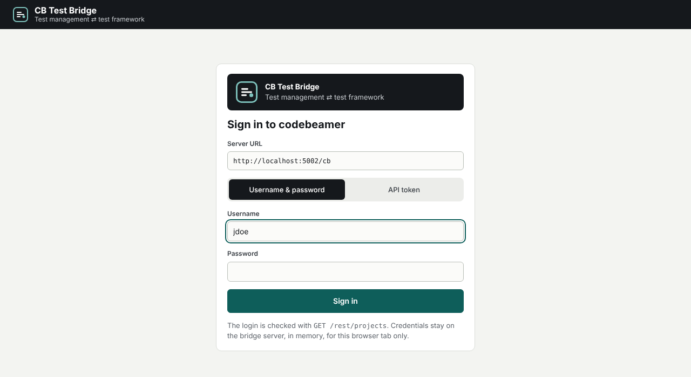
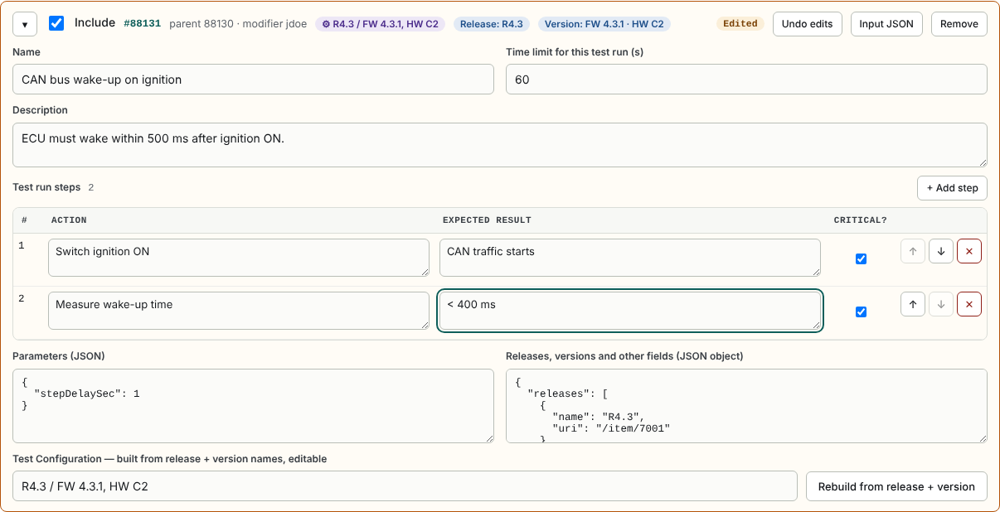
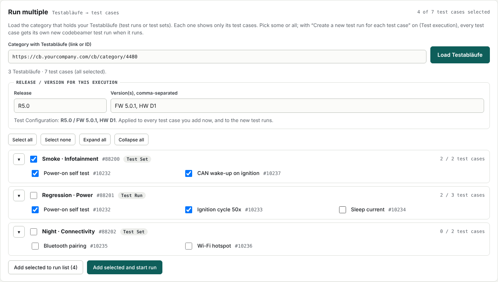
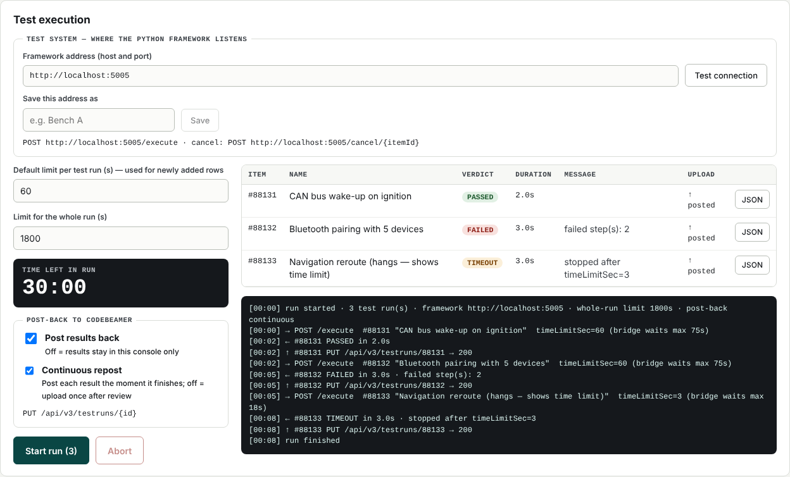

# User guide

For test engineers who pick tests from codebeamer, adjust them and run them on a test system.

- [1. Sign in](#1-sign-in)
- [2. Extract test runs](#2-extract-test-runs)
- [3. Review and edit before sending](#3-review-and-edit-before-sending)
- [Run multiple — Testabläufe and their test cases](#run-multiple--testabläufe-and-their-test-cases)
- [4. My tests — tests you write yourself](#4-my-tests--tests-you-write-yourself)
- [5. Choose the test system](#5-choose-the-test-system)
- [6. Run](#6-run)
- [7. Post results to codebeamer](#7-post-results-to-codebeamer)
- [8. What is remembered](#8-what-is-remembered)

---

## 1. Sign in

| Field | What to enter |
|---|---|
| **Server URL** | Your codebeamer address including the context path, e.g. `https://cb.yourcompany.com/cb` |
| **Username & password** or **API token** | Your own codebeamer credentials |

The bridge checks the login with one read call. Your password is kept only on the bridge server, in memory,
for this browser tab. **Reloading the page or closing the tab signs you out.**

## 2. Extract test runs

Paste a codebeamer link (or just an item ID) into **Source link** and press **Resolve & extract**.

| You paste | The bridge shows |
|---|---|
| a **project** link `…/project/29` | the project and its categories → **Open outline** on a category |
| a **category** link `…/category/4471` | the outline (tree) of that category — select rows → **Use selected as test runs** |
| an **item** link `…/item/10231` or `10231` | the item and its **references** |

Every table has a search box, and **Raw JSON of the first row** shows the data exactly as codebeamer sent it.

### Test cases with many test runs

A test case whose parameter set generated many runs (e.g. 14) lists them all as references.

- The table starts on **Newest test run only** — the most recently created run (highest item ID).
- Switch it off to see all runs. The **type** chips (e.g. *Test Run 14 · Requirement 1*) hide everything that
  is not a test run.
- Tick the header checkbox to select all, then **Use selected as test runs**.

Nothing is added to your run list until you choose it.

## 3. Review and edit before sending

Chosen test runs appear in **Test runs to send**. Each one is a card:

| Part | Notes |
|---|---|
| **Include** | Only included test runs are sent. *Include all / Include none* for many at once. |
| **Name, Description** | Free text. |
| **Time limit (s)** | How long this test run may take before the framework must stop it. |
| **Test run steps** | One row per step: *Action*, *Expected result*, *Critical?*. Add, delete (✕) and reorder (↑ ↓). |
| **Parameters** | JSON, passed to the framework unchanged. |
| **Releases, versions…** | JSON taken from codebeamer. |
| **Test Configuration** | Built from the release and version names, e.g. `R4.3 / FW 4.3.1, HW C2`. Edit it freely; **Rebuild from release + version** recreates it after you changed releases/versions. |

Badges in the card header show the test configuration, release and version at a glance.

- Changed cards are marked **Edited**; **Undo edits** restores what was extracted.
- **Input JSON** downloads exactly what the framework will receive — useful for developers (see
  [Framework contract → CLI](framework-contract.md#developer-command-line)).
- When you add more than three test runs at once they arrive **folded** to one line. Use ▸ or *Expand all*.
- A red message under a box (e.g. *Not valid JSON*) excludes that test run from sending until it is fixed.

## Run multiple — Testabläufe and their test cases

For a category whose items are **Testabläufe** (test runs or test sets), each linking to test cases.

1. Enter the category link or ID in **Run multiple** and press **Load Testabläufe**. Each Testablauf becomes a group
   that shows **only its test cases** (folders and other links such as requirements are left out).
2. Enter **Release** and **Version(s)** once. They are applied to every test case you add now and build the
   Test Configuration (preview shown, e.g. `R5.0 / FW 5.0.1, HW D1`). Leave them empty to keep each test case's own.
3. Choose what to run: tick single test cases, a whole Testablauf (checkbox next to its name), or **Select all**.
   A test case linked from two Testabläufe appears in both and runs once for each.
4. **Add selected to run list** (review/edit first) or **Add selected and start run**.

In **Test execution**, the **Run multiple** box decides what happens in codebeamer:

| Create a new test run for each test case | Result |
|---|---|
| **On** (default) | Just before a test case runs, a **new codebeamer test run** is created for it, with the chosen release/versions. The framework receives the new run's ID; the result is posted to that run (live or with *Upload results*, as set under *Post-back*). |
| **Off** | Test cases run without a codebeamer test run; results stay in the console. |

Runs are created **one by one, right before each test case**, so an aborted or time-limited run does not leave
empty test runs behind for test cases that never started. In the results table, a row shows the new run and the
test case it came from, e.g. `#90001 · TC #10232`.

> If the box shows *TestRunTrackerId is not set*, your administrator still has to enter where new test runs are
> created. In dry-run mode nothing is created; the log shows what would have been sent.

## 4. My tests — tests you write yourself

| Action | Result |
|---|---|
| **+ New test** | A blank test appears at the top of *Test runs to send*, with the same editor. |
| **Save to My tests** | Keeps it in the *My tests* list (in your browser). |
| **Add to run list** | Puts a saved test back into *Test runs to send*. |
| **Import test JSON** | Loads a file — for example one saved with *Input JSON* — as a new test. |

Your own tests have IDs like `local-4ef446` and are **never posted to codebeamer**.

## 5. Choose the test system

In **Test execution → Test system** enter where the test framework listens — host and port,
e.g. `localhost:5001` or `10.0.0.12:8080`.

- **Test connection** checks that it answers.
- **Save this address as** "Bench A" keeps it as a one-click button. Switching to a saved system also tests the connection.

## 6. Run

| Setting | Meaning |
|---|---|
| **Default limit per test run** | Used for test runs added from now on (each card has its own limit). |
| **Limit for the whole run** | When it is used up, the running test is stopped and the rest are marked **NOT RUN**. |

Press **Start run (N)**. Test runs are sent **one at a time**. Each result appears in the table with its verdict,
duration and message; **JSON** shows the framework's full answer. **Abort** stops the running test and skips
the rest.

| Verdict | Meaning |
|---|---|
| PASSED / FAILED / BLOCKED | Reported by the framework |
| TIMEOUT | The test hit its time limit and was stopped |
| ABORTED | You pressed Abort while it ran |
| NOT RUN | Never started (abort or whole-run limit) |
| ERROR | Framework unreachable or answered something the bridge could not read |

## 7. Post results to codebeamer

| Option | Behaviour |
|---|---|
| **Post results back** off | Nothing is written to codebeamer. |
| **Post results back** on, **Continuous repost** on | Each result is posted the moment its test finishes. |
| **Post results back** on, **Continuous repost** off | Review first, then press **Upload results**. |

Only PASSED, FAILED, BLOCKED and TIMEOUT results are posted — never aborted, not-run or your own tests.
The **Upload** column shows *posted*, *failed*, *dry run* or *n/a*.

> If the column says **dry run**, your administrator has the bridge in safe mode: nothing is written.

## 8. What is remembered

| Where | What |
|---|---|
| **Your browser** (survives reload) | My tests, saved test systems, last framework address |
| **Bridge server, results folder** | Every result of every run: the exact request, the framework's full answer, verdict and upload state — one file per test plus a `run.json` per run. The log shows the folder at the start of each run. Kept for 90 days by default. |
| **Not kept** | The codebeamer login; the run list and results table on screen (reload clears them — the files stay) |
